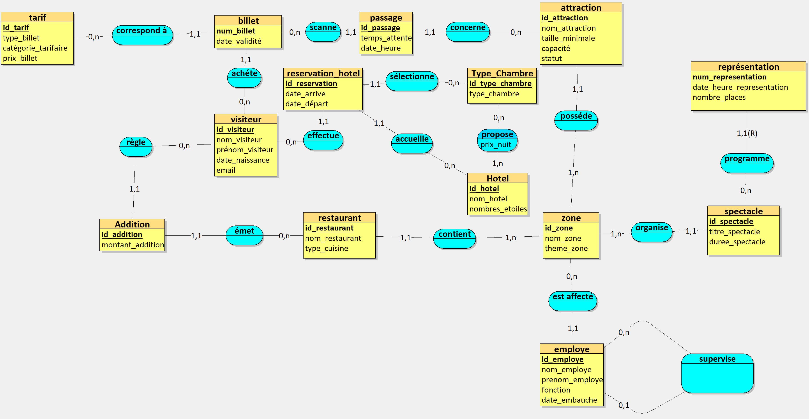

Projet MERISE  Gestion d’un parc d’attractions

Dans le cadre du projet, nous avons choisi le domaine des loisirs et du divertissement, plus précisément l’exploitation d’un parc d’attractions. Notre objectif est d’analyser les besoins d’une entreprise fictive afin de préparer la conception de son système d’information selon la méthode MERISE.

Nous avons d’abord rédigé un prompt définissant le rôle de l’intelligence artificielle, le contexte de l’entreprise, des références à trois parcs existants (Disneyland Paris, Parc Astérix et Europa-Park) ainsi que les résultats attendus : une liste de règles de gestion et un dictionnaire de 25 à 35 données. Nous avons ensuite soumis ce prompt à l’IA, puis examiné les règles et le dictionnaire produits pour vérifier leur cohérence avec notre demande. Le résultat initial comportait 25 règles de gestion et 34 données.

Lors de la préparation du MCD, nous avons ajouté une règle de gestion relative à la supervision des employés afin de représenter une relation hiérarchique entre employés
Après l'ajout de la règle de supervision, la liste ci-dessous contient 26 règles. Le dictionnaire de données initial reste inchangé (34 données) : cette nouvelle règle porte sur les liens entre employés et ne nécessite pas de nouvel attribut métier.

1. Prompt utilisé
Le texte ci-dessous reprend le prompt soumis à l’IA :

Tu travailles dans le domaine du loisir et du divertissement. Ton entreprise a comme activité de l’exploitation d’un parc d’attraction. C’est une entreprise comme Disneyland, Astérix, Europa Park. Les données sont collectées sur les visiteurs, les attractions, les employés, les billets, les spectacles, les restaurants, hôtels et les différentes zones du parc. Inspire-toi du site web suivant : https://www.disneylandparis.com/fr-fr,https://www.parcasterix.fr/, https://www.europapark.de/fr .
Ton entreprise veut appliquer MERISE pour concevoir un système d'information. Tu es chargé de la partie analyse, c’est-à-dire de collecter les besoins auprès de l’entreprise. Elle a fait appel à un étudiant en ingénierie informatique pour réaliser ce projet, tu dois lui fournir les informations nécessaires pour qu’il applique ensuite lui-même les étapes suivantes de conception et développement de la base de données.
D’abord, établis les règles de gestions des données de ton entreprise sous la forme d'une liste à puce. Elle doit correspondre aux informations que fournit quelqu’un qui connaît le fonctionnement de l’entreprise, mais pas comment se construit un système d’information.
Ensuite, à partir de ces règles, fournis un dictionnaire de données brutes avec les colonnes suivantes, regroupées dans un tableau : signification de la donnée, type, taille en nombre de caractères ou de chiffres. Il doit y avoir entre 25 et 35 données. Il sert à fournir des informations supplémentaires sur chaque donnée (taille et type) mais sans a priori sur comment les données vont être modélisées ensuite.
Fournis donc les règles de gestion et le dictionnaire de données.

2. Règles de gestion

   Les règles suivantes proviennent du document obtenu auprès de l’IA.
- 1. Visiteurs — Le parc accueille des visiteurs. Pour chacun, nous connaissons son nom, son prénom, sa date de naissance et son adresse e-mail.
- 2. Visiteurs — Un visiteur peut acheter plusieurs billets, par exemple pour toute sa famille ou pour des séjours différents. Un même visiteur peut donc revenir plusieurs fois au parc.
- 3. Billets — Chaque billet porte un numéro unique et est acheté par un seul visiteur. Il est utilisé par une seule personne.
- 4. Billets — Il existe plusieurs types de billets : 1 jour, 2 jours, annuel, etc.
- 5. Billets — Le prix dépend du type de billet et de la catégorie tarifaire de la personne : enfant, adulte ou senior.
- 6. Billets — Un billet est valable à partir d'une date de validité précise. Pour un billet de plusieurs jours, c'est la date du premier jour.
- 7. Zones du parc — Le parc est découpé en zones thématiques, par exemple un royaume médiéval, une zone aquatique ou une zone dédiée aux enfants.
- 8. Zones du parc — Chaque zone a un nom unique et un thème.
- 9. Zones du parc — Une zone regroupe plusieurs attractions, plusieurs restaurants et plusieurs salles de spectacle.
- 10. Zones du parc — Une attraction, un restaurant ou un spectacle se trouve dans une seule zone.
- 11. Attractions — Chaque attraction a un nom, une taille minimale requise (en cm), une capacité (nombre de personnes par tour) et un statut : ouverte, fermée ou en maintenance.
- 12. Attractions — Lorsqu'un visiteur entre dans une attraction, son billet est scanné. Nous enregistrons alors la date et l'heure de passage ainsi que le temps d'attente en minutes.
- 13. Attractions — Un visiteur peut faire plusieurs fois la même attraction dans la journée, et plusieurs attractions différentes.
- 14. Attractions — Un billet doit être valable le jour du passage pour accéder à une attraction.
- 15. Spectacles — Chaque spectacle a un titre et une durée en minutes.
- 16. Spectacles — Un même spectacle peut être joué plusieurs fois par jour, à des dates et heures différentes.
- 17. Spectacles — Chaque représentation dispose d'un nombre de places limité.
- 18. Restaurants — Chaque restaurant a un nom et un type de cuisine : rapide, buffet, gastronomique, etc.
- 19. Restaurants — Quand un visiteur règle un repas, nous enregistrons le montant de l'addition. Un visiteur peut manger dans plusieurs restaurants pendant son séjour.
- 20. Hôtels — Le parc possède plusieurs hôtels. Chacun a un nom et un nombre d'étoiles.
- 21. Hôtels — Un hôtel propose plusieurs types de chambres : standard, familiale, suite, etc.
- 22. Hôtels — Le prix par nuit dépend du type de chambre et de l'hôtel.
- 23. Hôtels — Un visiteur réserve un ou plusieurs types de chambres dans un hôtel, avec une date d'arrivée et une date de départ. Il peut faire plusieurs séjours à des périodes différentes.
- 24. Employés — Chaque employé a un nom, un prénom, une fonction (opérateur d'attraction, cuisinier, artiste, agent d'accueil, etc.) et une date d'embauche.
- 25. Employés — Un employé est affecté à une seule zone du parc à la fois. Une zone affecte plusieurs employés.
- 26. Employés — Un employé peut superviser plusieurs autres employés, mais chaque employé ne peut avoir qu’un seul superviseur au maximum.
 
 3. Dictionnaire de données
    
    ## Dictionnaire de données

| N° | Attribut| Type |
|---|---|---|
| 1 | Nom du visiteur | VARCHAR() |
| 2 | Prénom du visiteur | VARCHAR() |
| 3 | Date de naissance du visiteur | DATE |
| 4 | Adresse e-mail du visiteur | VARCHAR() |
| 5 | Numéro du billet | INT |
| 6 | Type de billet (1 jour, 2 jours, annuel…) | VARCHAR() |
| 7 | Catégorie tarifaire (enfant, adulte, senior) | VARCHAR() |
| 8 | Date de validité du billet | DATE |
| 9 | Prix du billet en euros | DECIMAL() |
| 10 | Nom de la zone | VARCHAR() |
| 11 | Thème de la zone | VARCHAR() |
| 12 | Nom de l'attraction | VARCHAR() |
| 13 | Taille minimale requise (en cm) | INT |
| 14 | Capacité de l'attraction (personnes par tour) | INT |
| 15 | Statut de l'attraction (ouverte, fermée, maintenance) | VARCHAR() |
| 16 | Date et heure de passage dans l'attraction | DATETIME |
| 17 | Temps d'attente avant l'attraction (en minutes) | INT |
| 18 | Titre du spectacle | VARCHAR() |
| 19 | Durée du spectacle (en minutes) | INT |
| 20 | Date et heure de la représentation | DATETIME |
| 21 | Nombre de places de la représentation | INT |
| 22 | Nom du restaurant | VARCHAR() |
| 23 | Type de cuisine du restaurant | VARCHAR() |
| 24 | Montant de l'addition en euros | DECIMAL() |
| 25 | Nom de l'hôtel | VARCHAR() |
| 26 | Nombre d'étoiles de l'hôtel | INT |
| 27 | Type de chambre (standard, familiale, suite…) | VARCHAR() |
| 28 | Prix de la chambre par nuit en euros | DECIMAL() |
| 29 | Date d'arrivée à l'hôtel | DATE |
| 30 | Date de départ de l'hôtel | DATE |
| 31 | Nom de l'employé | VARCHAR() |
| 32 | Prénom de l'employé | VARCHAR() |
| 33 | Fonction de l'employé | VARCHAR() |
| 34 | Date d'embauche de l'employé | DATE |

## 4. Modèle Conceptuel de Données (MCD)

Voici notre MCD pour la gestion d'un parc d'attractions.

   

